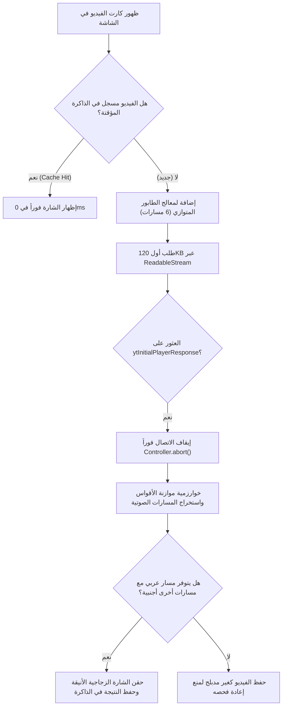

# 🎙️ مكتشف الفيديوهات المدبلجة للعربية في يوتيوب
### YouTube Arabic Dub Indicator — فائقة السرعة وموفرة للبيانات

إضافة متصفح احترافية، مفتوحة المصدر وخفيفة الوزن، تعمل تلقائياً أثناء تصفحك لمنصة **يوتيوب (YouTube)** لفحص الفيديوهات واكتشاف المقاطع الأجنبية التي تحتوي على **مسار صوتي عربي (دبلجة صوتية عربية)**، وتُظهر عليها شارة زجاجية أنيقة فوراً دون أي مجهود منك.

---

## 📑 فهرس المحتويات
1. [✨ أبرز المميزات (السرعة وتوفير الإنترنت)](#-أبرز-المميزات)
2. [🚀 دليل التثبيت والتشغيل بالتفصيل](#-دليل-التثبيت-والتشغيل-بالتفصيل)
   - [أولاً: المتصفحات المبنية على فايرفوكس (Firefox)](#1-المتصفحات-المبنية-على-فايرفوكس-firefox)
   - [ثانياً: المتصفحات المبنية على جوجل كروم (Google Chrome & Chromium)](#2-المتصفحات-المبنية-على-جوجل-كروم-chromium)
3. [🎬 دليل الاستخدام العملي والاختبار](#-دليل-الاستخدام-العملي-والاختبار)
4. [🎨 خيارات التخصيص والنافذة المنبثقة](#-خيارات-التخصيص-والنافذة-المنبثقة)
5. [🛠️ كيف تم بناء الإضافة هندسياً وتفاصيل الكود](#-كيف-تم-بناء-الإضافة-هندسياً-وكيف-تعمل)
   - [هيكل المشروع ومجلداته](#هيكل-الملفات)
   - [خوارزمية الفحص بدون API](#خوارزمية-الفحص-الذاتي-بدون-api)
   - [محرك المعالجة المتوازي والقطع المبكر](#تقنيات-الأداء-الفائق)
6. [❓ الأسئلة الشائعة وحل المشكلات](#-الأسئلة-الشائعة-وحل-المشكلات)

---

## ✨ أبرز المميزات

تم تصميم الإضافة بهندسة برمجية متطورة تهدف إلى تحقيق أقصى سرعة ممكنة مع الحفاظ التام على باقة الإنترنت وموارد الجهاز:

### ⚡ 1. سرعة فائقة واستجابة فورية (Hyper-Speed Turbo)
* **استجابة لحظية في 0 ثانية (0ms Cache Hit):** تعتمد الإضافة على ذاكرة تخزين مؤقت متزامنة في الذاكرة العشوائية (`In-Memory Cache`) بجانب التخزين المحلي (`LocalStorage`)، مما يتيح إظهار الشارة في جزء من الألف من الثانية للفيديوهات التي تم فحصها سابقاً دون الحاجة إلى انتظار أي عمليات غير متزامنة.
* **محرك متوازي بـ 6 مسارات (6 Parallel Workers):** تُعالج طلبات الفحص بالتوازي الكامل من خلال استغلال تقنية تعدد الإرسال (`Multiplexing`) عبر بروتوكول HTTP/2، مما يتيح معالجة دفعات متعددة من الفيديوهات بسرعة مذهلة دون أي تجميد للمتصفح.
* **طابور أولويات ثنائي ذكي (Dual Priority Queue):** ترتّب الإضافة الفيديوهات تلقائياً بحيث تكون الأولوية القصوى للفيديوهات المعروضة حالياً أمام عين المستخدم على الشاشة وفق ترتيب القراءة الطبيعي من الأعلى إلى الأسفل، تليها الفيديوهات الموجودة في منطقة التحميل المسبق.
* **هامش تحميل مسبق استباقي (1000px Pre-Fetch Margin):** تفحص الإضافة الفيديوهات القادمة على مسافة 1000 بكسل قبل وصولك إليها أثناء التمرير، لتباغتك الشارة بالظهور فور وصول الفيديو أمام عينيك مباشرة دون أي تأخير ملحوظ.

### 🌐 2. توفير هائل للإنترنت وباقة البيانات (Bandwidth & Data Saver)
* **تقنية القطع المبكر للبث (Stream Early-Abort):** 
  بدلاً من تنزيل صفحة الفيديو بالكامل (والتي يصل حجمها عادة إلى 1.5 - 2 ميجابايت من نصوص الـ HTML والأكواد)، تستخدم الإضافة واجهة `ReadableStream` لقراءة أول ~100 إلى 120 كيلوبايت فقط من الاستجابة حتى تصل إلى كائن بيانات المشغل، ثم تُطلق أمر إيقاف فوري للاتصال (`controller.abort()`).
  > 📉 **النتيجة:** توفير ما يزيد عن **90%** من استهلاك باقة الإنترنت مقارنة بالطرق التقليدية!
* **فلترة نصية مسبقة فائقة السرعة (String Pre-filter):** قبل إجراء عملية تحليل الـ JSON الثقيلة، تفحص الإضافة مصفوفة البيانات نصياً للتأكد من وجود الكلمات المفتاحية لمسارات الصوت العربية (`ar`، `ar.`، `arabic`، `العربية`)؛ فإذا لم تتواجد، يتم إهمال الفيديو فوراً في ميكرو-ثانية دون استهلاك المعالج.
* **تخزين ذكي طويل الأمد (Persistent FIFO Cache):** تُخزّن نتائج الفحص محلياً لمدة 7 أيام، مما يمنع فحص نفس الفيديو مرتين نهائياً طوال فترة بقائه في الذاكرة المؤقتة.
* **فحص الفيديوهات المعروضة فقط (`IntersectionObserver`):** لا يتم إرسال أي طلب فحص لأي فيديو إلا إذا كان داخلاً في مجال رؤية المستخدم أو قريباً جداً منه.

### 🎯 3. دقة استثنائية في التعرف على الدبلجة
* **تمييز ذكي بين الفيديوهات المدبلجة والعربية الأصلية:** الإضافة لا تضع الشارة عشوائياً على أي فيديو ناطق بالعربية؛ بل تتحقق من أن الفيديو يحتوي على مسارين صوتيين فأكثر (`totalAudioTracks >= 2`) وأن اللغة العربية ليست هي المسار الصوتي الأصلي، مما يمنع وسم القنوات والمقاطع العربية الأصلية بلا داعٍ.
* **توافق كامل مع تصاميم يوتيوب القديمة والحديثة:** تدعم الواجهة الحديثة (Wiz Layout المبنية على `yt-lockup-view-model` و `yt-thumbnail-view-model`) والتصميم الكلاسيكي (`ytd-thumbnail` و `#overlays`).

---

## 🚀 دليل التثبيت والتشغيل بالتفصيل

تعمل الإضافة بسلاسة تامة على جميع المتصفحات الحديثة، سواء كانت مبنية على محرك **فايرفوكس (Gecko)** أو محرك **كروميوم (Chromium)**.

---

### 1. المتصفحات المبنية على فايرفوكس (Firefox)
*(يشمل: Mozilla Firefox، Firefox Developer Edition، LibreWolf، Waterfox)*

تستخدم هذه المتصفحات ملف `manifest.json` المعد بإعدادات Manifest V2 ومعرف Gecko الخاص بفايرفوكس.

#### خطوات التثبيت:
1. افتح متصفح **فايرفوكس**.
2. انسخ الرابط التالي وضعه في شريط العنوان بالأعلى واضغط **Enter**:
   ```text
   about:debugging#/runtime/this-firefox
   ```
3. في الصفحة التي ستظهر لك، ابحث عن قسم **"هذا الـ Firefox" (This Firefox)**.
4. اضغط على زر **"تحميل إضافة مؤقتة..." (Load Temporary Add-on...)**.
5. سيفتح لك المتصفح نافذة لاختيار الملفات، توجه إلى مجلد المشروع:
   ```text
   c:\Users\فارس\Music\التعرف علي الفديوهات المدبلجة
   ```
6. اختر ملف **`manifest.json`** واضغط **فتح (Open)**.
7. ✨ **تم التثبيت بنجاح!** ستظهر أيقونة الإضافة في شريط أدوات المتصفح وستبدأ بالعمل فوراً عند زيارة موقع يوتيوب.

---

### 2. المتصفحات المبنية على جوجل كروم (Chromium)
*(يشمل: Google Chrome، Microsoft Edge، Brave، Opera، Vivaldi)*

تتطلب متصفحات كروميوم الحديثة نظام **Manifest V3**. مجلد المشروع يحتوي بالفعل على ملف مهيأ خصيصاً لكروم باسم `manifest.chrome.json`.

#### الخطوة الأولى: تهيئة ملف الـ Manifest لكروم
نظراً لأن متصفح كروم يبحث دائماً عن ملف باسم `manifest.json` تحديداً، قم باتباع إحدى الطريقتين التاليتين:
* **الطريقة السريعة (تغيير الاسم):**
  1. قم بإعادة تسمية ملف `manifest.json` الحالي إلى `manifest.firefox.json` (للاحتفاظ به لفايرفوكس).
  2. قم بإعادة تسمية ملف `manifest.chrome.json` إلى **`manifest.json`**.
* **أو عبر سطر أوامر PowerShell:**
  افتح مجلد المشروع في PowerShell ونفّذ الأمر التالي:
  ```powershell
  Copy-Item -Path "manifest.chrome.json" -Destination "manifest.json" -Force
  ```

#### الخطوة الثانية: تحميل الإضافة في المتصفح
1. افتح متصفح **جوجل كروم** (أو Edge أو Brave).
2. في شريط العنوان، اكتب الرابط المناسب لمتصفحك واضغط **Enter**:
   * في متصفح كروم: `chrome://extensions`
   * في متصفح إيدج: `edge://extensions`
   * في متصفح بريف: `brave://extensions`
3. قم بتفعيل خيار **"وضع مطوّر البرامج" (Developer mode)** من الزاوية العلوية (عادة في أعلى اليمين أو اليسار).
4. اضغط على زر **"تحميل إضافة تم فك حزمتها" (Load unpacked)**.
5. اختر مجلد المشروع بالكامل:
   ```text
   c:\Users\فارس\Music\التعرف علي الفديوهات المدبلجة
   ```
   *(اختر المجلد الرئيسي نفسه واضغط "Select Folder").*
6. ✨ **مبروك!** أصبحت الإضافة نشطة ومثبتة. يُفضل تثبيت أيقونتها (Pin) في شريط الأدوات لتسهيل الوصول إلى خيارات التخصيص.

---

## 🎬 دليل الاستخدام العملي والاختبار

1. توجه إلى موقع **[YouTube.com](https://www.youtube.com)**.
2. اكتب في شريط البحث اسم إحدى القنوات العالمية الشهيرة بدبلجة مقاطعها إلى اللغة العربية، على سبيل المثال:
   * **MrBeast** (أحد أكبر صناع المحتوى الذين يوفرون مسارات عربية احترافية).
   * **Kurzgesagt – In a Nutshell** (فيديوهات العلوم والتبسيط).
   * **Mark Rober** (تجارب العلوم والهندسة).
   * **TED-Ed** أو **Veritasium** أو **Nas Daily**.
3. أثناء تمريرك في نتائج البحث أو الصفحة الرئيسية، ستلاحظ ظهور شارة زجاجية عصرية جذابة في زاوية الصورة المصغرة لكل فيديو مدبلج تحتوي على أيقونة سماعات الرأس وعبارة **"دبلجة عربية"**.
4. اضغط على الفيديو لتشغيله، ثم اضغط على أيقونة الإعدادات (⚙️) في مشغل يوتيوب -> **المسار الصوتي (Audio Track)**، وستجد بالفعل خيار **العربية (Arabic)** متوفراً.

---

## 🎨 خيارات التخصيص والنافذة المنبثقة

عند النقر على أيقونة الإضافة في شريط المتصفح، تفتح لك نافذة تحكم أنيقة متجاوبة تمكنك من تخصيص الإضافة بالكامل مع **معاينة حية فورية (Live Preview)**:

| عنصر التحكم | الخيارات المتاحة | الوصف والوظيفة |
| :--- | :--- | :--- |
| **المفتاح الرئيسي (Master Switch)** | تشغيل / تعطيل | إيقاف أو تشغيل فحص وإظهار الشارات فوراً دون الحاجة لإعادة تحميل الصفحة. |
| **سمة الألوان (Themes)** | نيلي (Indigo) / زمردي (Emerald) / ياقوتي (Rose) / ذهبي (Amber) | اختيار التدرج اللوني الذي يناسب ذوقك وتصميم يوتيوب الليلي أو النهاري. |
| **نص الشارة (Badge Text)** | "دبلجة عربية" / "عربي" / "صوت عربي" / "AR Dub" | اختيار العبارة التي تفضل رؤيتها على غلاف الفيديو. |
| **موضع الشارة (Position)** | أعلى اليمين (Right) / أعلى اليسار (Left) | تحديد زاوية الظهور لتفادي تغطية مدة الفيديو أو شعارات القنوات. |

> 💡 **ملاحظة:** يتم حفظ جميع الإعدادات فوراً في التخزين المتزامن للمتصفح وتُطبّق على كل الصفحات المفتوحة دون تأخير.

---

## 🛠️ كيف تم بناء الإضافة هندسياً وكيف تعمل

تم بناء المشروع باستخدام بنية برمجية نقية وخفيفة (Vanilla JavaScript, Modern CSS3, HTML5) دون أي أطر عمل خارجية ثقيلة، لضمان استهلاك شبه معدوم لذاكرة الرام والمعالج.

### هيكل الملفات
```text
التعرف علي الفديوهات المدبلجة/
├── manifest.json              # ملف التعريف الرسمي لمتصفحات فايرفوكس (Manifest V2)
├── manifest.chrome.json       # ملف التعريف المخصص لمتصفحات كروميوم (Manifest V3)
├── background/
│   └── background.js          # منسق الخلفية وإدارة التخزين المشترك والإحصائيات
├── content/
│   ├── content.js             # القلب النابض للإضافة: فحص التدفقات، الطوابير، وحقن الشارة
│   └── styles.css             # التنسيقات البصرية الزجاجية والتأثيرات الحركية (Glassmorphism)
├── popup/
│   ├── popup.html             # هيكل واجهة التحكم المنبثقة والمعاينة الحية
│   ├── popup.css              # تصميم واجهة التحكم المتوافقة مع الاتجاه من اليمين لليسار (RTL)
│   └── popup.js               # منطق التحكم اللحظي وحفظ التفضيلات
├── icons/
│   ├── icon-16.png            # أيقونة بحجم 16x16
│   ├── icon-48.png            # أيقونة بحجم 48x48
│   └── icon-128.png           # أيقونة عالية الدقة بحجم 128x128
└── README.md                  # دليل المشروع والتوثيق الشامل
```

---

### خوارزمية الفحص الذاتي بدون API

لا تعتمد الإضافة على أي خوادم خارجية أو واجهات برمجة مدفوعة (مثل YouTube Data API v3) التي تتطلب مفاتيح سرية ولها حدود يومية؛ بل تعتمد على استخراج بيانات صفحة العرض المضمنة بنفس أسلوب مشغل يوتيوب الرسمي:



#### 1. موازن الأقواس الدقيق (Balanced Brace Matching):
بدلاً من استخدام التعابير النمطية (`RegEx`) المعرضة للخطأ عند قراءة كائنات الـ JSON الضخمة التي تحتوي على نصوص معقدة، تحتوي الإضافة على محلل خطي سريع يتتبع عدد الأقواس المفتوحة والمغلقة (`{ ... }`) مع مراعاة علامات التنصيص وحالات الهروب (`Escape Characters \`) بدقة `O(N)`، مما يستخرج كائن البيانات كاملاً وبسرعة قياسية.

#### 2. فحص المسارات المتكيفة وقوائم الترجمة الصوتية:
تقوم الإضافة بالدمج الذكي للمسارات الصوتية من مصدرين داخل استجابة المشغل:
* `playerData.streamingData.adaptiveFormats` (مسارات الصوت الفعلية ذات الجودة المتكيفة).
* `playerData.captions.playerCaptionsTracklistRenderer.audioTracks` (قوائم المسارات الصوتية المسجلة).

#### 3. الفلترة الصارمة للغة:
تتأكد الإضافة من معرف المسار (`Track ID`) واسم العرض (`Display Name`):
```javascript
const isArabic = uniqueTracks.some(t => {
  const id = (t.id || '').toLowerCase();
  const name = (t.displayName || '').toLowerCase();
  return (
    id.startsWith('ar.') || id.startsWith('ar-') || id === 'ar' ||
    id.includes('.ar.') || id.endsWith('.ar') ||
    name.includes('arabic') || name.includes('العربية') || name.includes('عربي')
  );
});
```

---

### تقنيات الأداء الفائق

1. **القطع الفوري للتدفق (`Stream Early-Abort`):**
   ```javascript
   const reader = response.body.getReader();
   // قراءة أجزاء صغيرة من التدفق عبر Buffer
   // بمجرد العثور على البداية والنهاية لكائن المشغل:
   controller.abort(); // إغلاق المقبس فورا وتوفير 90% من استهلاك البيانات!
   ```
2. **المراقبة الكسولة عبر `IntersectionObserver`:**
   تراقب الإضافة روابط الفيديوهات بهامش `1000px` حول نافذة الرؤية، فلا يُطلب أي رابط خارج الشاشة قبل أوانه.
3. **التصميم الزجاجي المسرّع عتادياً (`GPU Accelerated CSS`):**
   تم تصميم الشارة بخاصية `backdrop-filter: blur(14px)` مع `will-change: transform, opacity`، مما يضمن عرض الحركات الانتقالية بنعومة 60/120 إطار في الثانية دون استهلاك المعالج المركزي.

---

## ❓ الأسئلة الشائعة وحل المشكلات

### س: هل تستهلك الإضافة الكثير من الإنترنت أو تبطئ التصفح؟
> **ج:** على الإطلاق! بفضل تقنية `Stream Early-Abort` والتخزين المؤقت في الذاكرة العشوائية، الإضافة تستهلك بضع كيلوبايتات فقط للفيديو الجديد، و **0 بايت** للفيديوهات التي تصفحتها سابقاً.

### س: هل الإضافة آمنة وهل تتطلب تسجيل الدخول بحساب جوجل؟
> **ج:** آمنة بنسبة 100% ومفتوحة المصدر. لا تجمع أي بيانات شخصية، ولا تتطلب تسجيل دخول، ولا ترسل أي بيانات إلى أي خادم خارجي. كل المعالجة تتم محلياً داخل جهازك.

### س: لم تظهر الشارة على فيديو أعلم أنه مدبلج، ما السبب؟
> **ج:** تأكد من الآتي:
> 1. أن الإضافة مفعلة من النافذة المنبثقة (المفتاح الرئيسي في وضع التشغيل).
> 2. أن الفيديو يمتلك فعلياً "مساراً صوتياً عربياً" (`Audio Track`) وليس مجرد ترجمة نصية (`Subtitles / CC`).
> 3. جرب عمل تحديث للصفحة (`F5`).

### س: كيف يمكنني مسح الذاكرة المؤقتة للبدء من جديد؟
> **ج:** يمكنك مسح بيانات التخزين المؤقت للإضافة عبر التوجه إلى إعدادات المتصفح وحذف بيانات التخزين المحلي ليوتيوب، أو من خلال فحص الكونسول واستدعاء `localStorage.removeItem('yt_dub_cache_v5')`.

---

## 📄 الترخيص (License)
هذا المشروع مفتوح المصدر ومتاح للاستخدام الشخصي والتطوير تحت رخصة **MIT**.
