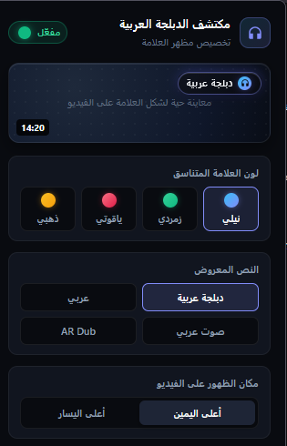
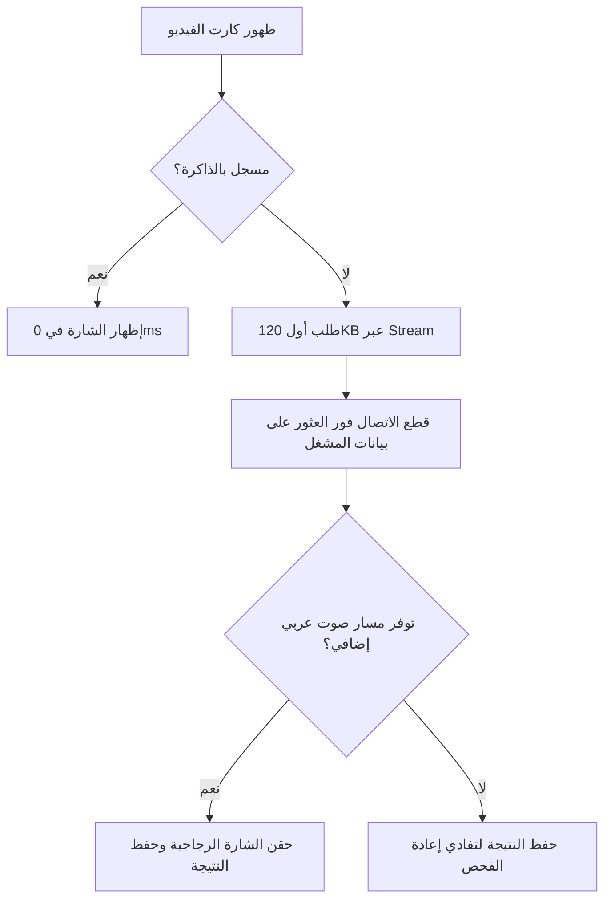

# 🎙️ مكتشف الفيديوهات المدبلجة للعربية في يوتيوب
> إضافة متصفح خفيفة وسريعة، تكتشف تلقائياً الفيديوهات الأجنبية التي تدعم **الدبلجة الصوتية العربية** على منصة يوتيوب وتُظهر عليها شارة أنيقة.

<div align="center">
  
</div>

---

## ⚡ أبرز المميزات

* **🚀 سرعة فائقة (0 ثانية):** استجابة فورية عبر التخزين المؤقت المزدوج (`Memory Cache` + `LocalStorage`) للفيديوهات المفحوصة مسبقاً.
* **🌐 توفير أكثر من 90% من البيانات:** تقنية القطع المبكر للبث (`Stream Early-Abort`) تقرأ أول ~120KB فقط من الصفحة وتوقف التحميل فوراً بدلاً من تحميل الصفحة كاملة (1.5MB+).
* **⚙️ معالجة متوازية (6 مسارات):** فحص متزامن وسلس عبر HTTP/2 دون أي بطء أو تجميد للمتصفح.
* **👁️ فحص ذكي واستباقي:** تفحص الفيديوهات المعروضة فقط (`IntersectionObserver`) مع هامش استباقي (1000px) قبل وصولك إليها أثناء التمرير.
* **🎯 دقة وفلترة صارمة:** تمييز ذكي بين الفيديوهات المدبلجة والمحتوى العربي الأصلي (لا تضع الشارة على مقاطع ناطقة بالعربية فقط).
* **🎨 تخصيص كامل ومعاينة حية:** نافذة إعدادات للتحكم في الألوان، النصوص، والمواضع، مع زر تشغيل/إيقاف فوري.

---

## 🚀 طريقة التثبيت والتشغيل

### 📥 1. تنزيل المشروع
قم بتنزيل ملفات الإضافة عبر زر **Code -> Download ZIP** بالأعلى وفك الضغط في أي مكان على جهازك، أو استنسخ المستودع عبر Git:
```bash
git clone https://github.com/<username>/<repo-name>.git
```

---

### 🦊 2. التثبيت على متصفح فايرفوكس (Firefox)
1. افتح فايرفوكس وتوجه إلى:
   ```text
   about:debugging#/runtime/this-firefox
   ```
2. اضغط على **"تحميل إضافة مؤقتة..." (Load Temporary Add-on...)**.
3. توجه إلى مجلد المشروع الذي قمت بتنزيله واختر ملف **`manifest.json`**.
4. ✨ الإضافة أصبحت نشطة ومثبتة!

---

### 🌐 3. التثبيت على متصفحات كروميوم (Google Chrome, Edge, Brave, Opera)

> **ملاحظة:** تتطلب متصفحات كروميوم نظام Manifest V3، وهو مهيأ مسبقاً في ملف `manifest.chrome.json`.

1. **تجهيز الملف:** داخل مجلد المشروع، قم بنسخ أو إعادة تسمية ملف `manifest.chrome.json` إلى **`manifest.json`** (أو استبدل الملف الحالي به).
2. افتح المتصفح واذهب إلى إدارة الإضافات:
   * **Chrome:** `chrome://extensions`
   * **Edge:** `edge://extensions`
   * **Brave:** `brave://extensions`
3. فعّل **"وضع مطوّر البرامج" (Developer mode)** من الزاوية العلوية.
4. اضغط على **"تحميل إضافة تم فك حزمتها" (Load unpacked)**.
5. اختر **مجلد المشروع الرئيسي**.
6. ✨ تم التثبيت بنجاح!

---

## 🎨 خيارات التخصيص

تتيح لك نافذة التحكم المنبثقة تخصيص شكل الشارة بالكامل مع **معاينة حية فورية**:

<div align="center">
  
</div>

| الإعداد | الخيارات | الوظيفة |
| :--- | :--- | :--- |
| **المفتاح العام** | تشغيل / إيقاف | تفعيل أو تعطيل الشارات لحظياً دون إعادة تحميل الصفحة. |
| **السمة اللونية** | نيلي • زمردي • ياقوتي • ذهبي | اختيار التدرج الزجاجي المتناسق مع مظهر يوتيوب. |
| **النص المعروض** | دبلجة عربية • عربي • صوت عربي • AR Dub | العبارة الظاهرة داخل الشارة. |
| **موضع الظهور** | أعلى اليمين • أعلى اليسار | تحديد زاوية الشارة على غلاف الفيديو. |

---

## 🛠️ كيف تعمل الإضافة هندسياً؟

تعمل الإضافة ذاتياً دون الحاجة لأي مفاتيح برمجية (API Keys) أو خوادم خارجية، عبر تحليل بيانات المشغل المضمنة محلياً:



### هيكل الملفات
```text
├── assets/                    # صور المعاينة والتوثيق
├── background/
│   └── background.js          # إدارة التخزين المشترك وتنسيق المهام
├── content/
│   ├── content.js             # فحص التدفقات، الطوابير، وحقن الشارة
│   └── styles.css             # التنسيقات الزجاجية (Glassmorphism)
├── popup/
│   ├── popup.html             # واجهة التحكم والمعاينة الحية
│   ├── popup.css / popup.js   # تصميم ومنطق نافذة الإعدادات
├── icons/                     # أيقونات الإضافة (16, 48, 128)
├── manifest.json              # إعدادات فايرفوكس (Manifest V2)
└── manifest.chrome.json       # إعدادات كروم (Manifest V3)
```

---

## ❓ أسئلة شائعة

* **هل تستهلك الإضافة باقة الإنترنت؟**  
  لا؛ بفضل تقنية قطع الاتصال المبكر والتخزين المؤقت، لا تُحمّل سوى أجزاء ضئيلة جداً (~120KB) وتستهلك 0 بايت للفيديوهات التي فُحصت سابقاً.
* **هل الإضافة آمنة وتحفظ الخصوصية؟**  
  آمنة 100% ومفتوحة المصدر؛ تعمل محلياً داخل متصفحك بالكامل ولا تجمع أو ترسل أي بيانات لأي خادم خارجي.

---

## 📄 الترخيص
هذا المشروع مرخص تحت رخصة **MIT** ومتاح مجاناً للاستخدام والتطوير.
